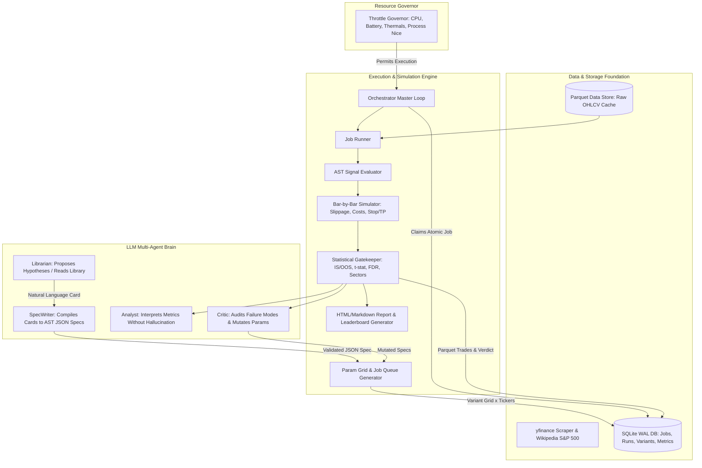
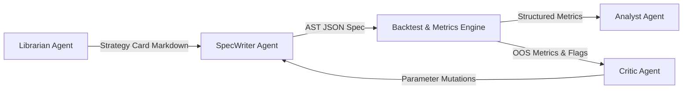
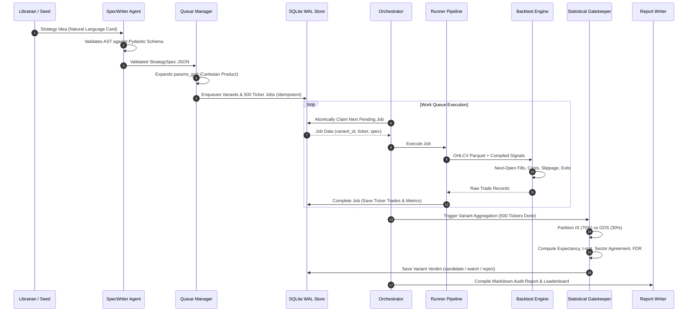

# Strategy Lab: Comprehensive Architectural & Technical Documentary
**Standard:** Quantitative Engineering & Research Architecture (Interview Standard)  
**Author:** Quantitative Systems Engineering Team  
**System:** Autonomous Idle-Time Price-Action Quantitative Research Lab  
**Repository:** `strategy-lab`

---

## Table of Contents
1. [Executive Summary & Core Philosophy](#1-executive-summary--core-philosophy)
2. [High-Level System Architecture](#2-high-level-system-architecture)
3. [Repository Directory & Module Topology](#3-repository-directory--module-topology)
4. [File-by-File Deep Dive & Implementation Mechanics](#4-file-by-file-deep-dive--implementation-mechanics)
   - [4.1 Configuration Layer (`lab/config.py`)](#41-configuration-layer-labconfigpy)
   - [4.2 Universe Ingestion & Categorization (`lab/universe.py`)](#42-universe-ingestion--categorization-labuniversepy)
   - [4.3 Market Data Engine & Hygiene (`lab/data.py`)](#43-market-data-engine--hygiene-labdatapy)
   - [4.4 Technical Indicators Engine (`lab/indicators.py`)](#44-technical-indicators-engine-labindicatorspy)
   - [4.5 Candlestick Pattern Recognition (`lab/patterns.py`)](#45-candlestick-pattern-recognition-labpatternspy)
   - [4.6 Strategy Domain-Specific Language (`lab/spec.py`)](#46-strategy-domain-specific-language-labspecpy)
   - [4.7 AST Signal Compiler & Evaluation Tree (`lab/signals.py`)](#47-ast-signal-compiler--evaluation-tree-labsignalspy)
   - [4.8 Event-Driven Bar Simulation Engine (`lab/backtest.py`)](#48-event-driven-bar-simulation-engine-labbacktestpy)
   - [4.9 Quantitative Statistical Gatekeeper (`lab/metrics.py`)](#49-quantitative-statistical-gatekeeper-labmetricspy)
   - [4.10 Persistence Layer & ACID State Machine (`lab/store.py`)](#410-persistence-layer--acid-state-machine-labstorepy)
   - [4.11 Parameter Space Grid & Queue Generator (`lab/queue.py`)](#411-parameter-space-grid--queue-generator-labqueuepy)
   - [4.12 Execution Worker Pipeline (`lab/runner.py`)](#412-execution-worker-pipeline-labrunnerpy)
   - [4.13 System Resource & Thermal Governor (`lab/throttle.py`)](#413-system-resource--thermal-governor-labthrottlepy)
   - [4.14 Reporting & Leaderboard Synthesis (`lab/report.py`)](#414-reporting--leaderboard-synthesis-labreportpy)
   - [4.15 Local LLM Orchestration (`lab/llm.py`)](#415-local-llm-orchestration-labllmpy)
   - [4.16 Multi-Agent Reasoning Subsystem (`lab/agents/`)](#416-multi-agent-reasoning-subsystem-labagents)
   - [4.17 Master Orchestrator Loop (`lab/orchestrator.py`)](#417-master-orchestrator-loop-laborchestratorpy)
   - [4.18 Command-Line Interface (`lab/cli.py`)](#418-command-line-interface-labclipy)
5. [End-to-End Execution & Data Flow Lifecycle](#5-end-to-end-execution--data-flow-lifecycle)
6. [Anti-Overfitting & Statistical Rigor Framework](#6-anti-overfitting--statistical-rigor-framework)
7. [Unit Testing & Verification Architecture](#7-unit-testing--verification-architecture)
8. [Senior Quantitative Developer Interview Guide (15 Technical Questions & Answers)](#8-senior-quantitative-developer-interview-guide)

---

## 1. Executive Summary & Core Philosophy

**Strategy Lab** is an industrial-grade, autonomous quantitative research platform designed to operate continuously in the background of a workstation without disrupting user workflow. It systematically develops, backtests, evaluates, critiques, and mutates price-action, momentum, and mean-reversion trading strategies across the entire S&P 500 equity universe.

### Key Tenets:
1. **Zero Compute Interference (Background Governor):** Uses OS process nice levels (`IDLE_PRIORITY_CLASS`), CPU duty cycles, thread capping, and thermal/battery constraints so the developer/trader never feels system degradation.
2. **Deterministic, Safe Strategy Representation (No `eval`):** Strategies are expressed as an Abstract Syntax Tree (AST) in a strict JSON Domain-Specific Language (DSL), parsed and validated via Pydantic v2. No arbitrary Python execution is permitted.
3. **Execution Realism & Lookahead Elimination:** Strictly separates signal generation at bar $t$ close from execution at bar $t+1$ open. Accounts for realistic bid-ask spread slippage, exchange commission fees, intra-bar stop-loss precedence, and gap exclusions.
4. **Anti-P-Hacking & Rigorous Statistical Gatekeeping:** Implements strict Chronological In-Sample (70%) vs Out-of-Sample (30%) partitioning, Student's $t$-statistic hypothesis testing on trade returns, cross-sector robustness validation, and Benjamini-Hochberg False Discovery Rate (FDR) adjustments to conquer the Multiple Testing Problem.
5. **ACID State Persistence & Crash Resilience:** Relies on a single-file SQLite database configured with Write-Ahead Logging (WAL) and atomic job transitions. Power outages, system crashes, or laptop restarts do not corrupt data or lose progress; stale in-flight jobs are recovered automatically.
6. **Constrained Multi-Agent Feedback Loop:** Integrates local LLMs (via Ollama) inside tightly bounded roles (Librarian, SpecWriter, Analyst, Critic). Prevents LLM hallucinations by never asking the LLM to compute math; numeric metrics are injected into prompts, and Critic mutations are constrained to grammar-compliant specs.

---

## 2. High-Level System Architecture



---

## 3. Repository Directory & Module Topology

```
strategy-lab/
├── config.yaml                    # System configuration: paths, backtest params, verdicts, throttle, LLM
├── requirements.txt               # Dependencies: numpy, pandas, pydantic, typer, rich, psutil, pyarrow, etc.
├── README.md                      # High-level user guide and setup instructions
├── data/                          # Runtime data root (gitignored)
│   ├── universe.csv               # S&P 500 constituent tickers, company names, and GICS sectors
│   ├── prices/                    # 12-year OHLCV daily data cached as {TICKER}.parquet
│   ├── results/                   # Trade logs per variant: {VARIANT_ID}/{TICKER}.parquet
│   └── lab.db                     # SQLite database in WAL mode storing queue, metrics, and runs
├── library/                       # Quantitative strategy library
│   ├── strategies.md              # Markdown catalog of strategy cards with rationale & failure modes
│   └── specs/                     # JSON serialized StrategySpec files
├── reports/                       # Generated research artifacts
│   ├── leaderboard.md             # Markdown ranking of tested strategies
│   └── *.md                       # Per-variant detailed performance audit reports
├── logs/                          # System log output
│   └── lab.log                    # Rotating file log with microsecond timestamping
├── lab/                           # Core Python Package
│   ├── __init__.py                # Package root
│   ├── __main__.py                # Entrypoint for `python -m lab`
│   ├── config.py                  # Dataclasses and Pydantic configuration loader
│   ├── universe.py                # S&P 500 Wikipedia scraper and sector mapper
│   ├── data.py                    # yfinance downloader, data cleaning, validation, Parquet storage
│   ├── indicators.py              # Pure NumPy/Pandas vectorized technical indicators
│   ├── patterns.py                # 12+ vectorized candlestick pattern recognition engines
│   ├── spec.py                    # AST DSL Schema, Pydantic models, whitelists, validation
│   ├── signals.py                 # Recursive condition tree compiler and vector evaluator
│   ├── backtest.py                # Bar-by-bar execution simulator with costs, slippage, and exits
│   ├── metrics.py                 # Quantitative metrics, t-stat, FDR, Sharpe, Sortino, Verdicts
│   ├── store.py                   # SQLite database access layer, migrations, atomic transactions
│   ├── queue.py                   # Cartesian grid expansion, variant hashing, queue analytics
│   ├── runner.py                  # End-to-end single job (variant × ticker) execution pipeline
│   ├── throttle.py                # Hardware governor: CPU, thermals, battery, OS process priority
│   ├── report.py                  # Research report generator & Markdown leaderboard writer
│   ├── llm.py                     # Ollama HTTP API client with retries and structured outputs
│   ├── logging_setup.py           # Structured logging configuration
│   ├── orchestrator.py            # Master asynchronous state machine loop
│   ├── cli.py                     # Typer CLI application (`init`, `run`, `status`, `stop`, etc.)
│   └── agents/                    # LLM Multi-Agent Reasoning Subsystem
│       ├── __init__.py
│       ├── librarian.py           # Seed card importer and LLM strategy proposal generator
│       ├── spec_writer.py         # Card-to-AST JSON compiler with self-correcting validation
│       ├── analyst.py             # Grounded quantitative commentary generator (zero hallucinations)
│       ├── critic.py              # Adversarial reviewer proposing targeted parameter mutations
│       └── prompts/               # Prompt templates for LLM agents
└── tests/                         # Comprehensive Unit Test Suite
    ├── conftest.py                # Pytest fixtures and mock OHLCV generators
    ├── test_backtest.py           # Trade simulation, cost deduction, and exit priority tests
    ├── test_indicators.py         # Numerical precision tests for all technical indicators
    ├── test_metrics.py            # Financial and statistical metric verification tests
    ├── test_patterns.py           # Candlestick pattern detection unit tests
    ├── test_signals.py            # Recursive AST condition evaluation tests
    ├── test_spec.py               # Spec schema validation, bounds checking, and security tests
    ├── test_store_queue.py        # SQLite transactions, queue idempotency, and crash recovery tests
    └── test_universe.py           # Universe fetching and sector parsing tests
```

---

## 4. File-by-File Deep Dive & Implementation Mechanics

### 4.1 Configuration Layer (`lab/config.py`)
- **Primary Responsibility:** Type-safe configuration management parsing `config.yaml` using Python dataclasses.
- **Key Data Structures:**
  - `PathsConfig`: Directory paths for data, library, reports, and logs.
  - `UniverseConfig`: Source (`sp500`), max ticker cap, custom ticker injections, forex toggles.
  - `DataConfig`: Lookback window (12 years), bar interval (`1d`), minimum required history (500 bars), rate-limiting sleep intervals, and cache freshness thresholds (20 hours).
  - `BacktestConfig`: Execution model (`next_open`), transaction costs (5 bps/side), slippage (5 bps/side), Out-of-Sample fraction (30%), forward horizons ($[1, 3, 5, 10, 20]$ bars), maximum parameter grid variants (30).
  - `VerdictConfig`: Statistical acceptance gates: minimum OOS trades (60), minimum $t$-statistic ($\ge 2.0$), False Discovery Rate $\alpha$ ($0.10$), minimum sector agreement ($60\%$).
  - `ThrottleConfig`: Worker thread allocation (2 threads), maximum CPU utilization threshold ($50\%$), duty cycle sleep ($0.5s$), battery and GPU thermal thresholds ($82^\circ\text{C}$).
  - `LLMConfig`: Ollama host endpoint, model identifier (`qwen2.5:3b`), inference temperature ($0.2$), HTTP timeout ($120s$).
- **Fail-Safe Design:** Validates directory existence and converts relative paths to absolute paths. Automatically raises structured `ValueError` exceptions if numeric thresholds violate mathematical domains.

### 4.2 Universe Ingestion & Categorization (`lab/universe.py`)
- **Primary Responsibility:** Discovers, normalizes, and classifies the equity universe.
- **Core Functions:**
  - `fetch_sp500(timeout: int = 30) -> pd.DataFrame`: Scrapes Wikipedia's table of S&P 500 constituents using `requests` with custom browser `User-Agent` headers to avoid HTTP 403 blocks. Normalizes column headers across Wikipedia revisions.
  - `_normalise_ticker(sym: str) -> str`: Converts dot notation (e.g., `BRK.B`, `BF.B`) to hyphen notation (`BRK-B`, `BF-B`) for 100% compatibility with Yahoo Finance symbology.
  - `SECTOR_ETFS`: Canonical mapping of all 11 Global Industry Classification Standard (GICS) sectors to their SPDR benchmark ETFs (`XLK`, `XLF`, `XLV`, `XLY`, `XLP`, `XLE`, `XLU`, `XLB`, `XLRE`, `XLC`, `XLI`).
  - `build_universe(data_dir, extra_tickers, max_tickers) -> pd.DataFrame`: Persists universe metadata to `data/universe.csv`. If internet connectivity drops, gracefully falls back to the existing local CSV cache.

### 4.3 Market Data Engine & Hygiene (`lab/data.py`)
- **Primary Responsibility:** Robust, rate-limited ingestion, validation, and Parquet caching of historical daily OHLCV bars.
- **Architectural Mechanics:**
  - **Batching & Rate-Limiting:** Downloads in batches of 25 tickers via `yfinance.download()` with a 5-second sleep between batches, eliminating HTTP 429 rate-limiting bans.
  - **Column Normalization (`_normalise_frame`):** Flattens multi-index column headers returned by multi-ticker yfinance queries. Strips timezone offsets to ensure UTC-naive `pd.DatetimeIndex` integrity.
  - **Strict Data Hygiene Gatekeeper (`_validate`):** Rejects corrupt data using zero-tolerance checks:
    1. Monotonically increasing, deduplicated dates.
    2. Zero or negative price detection ($Open, High, Low, Close \le 0$).
    3. High-Low consistency checks ($High \ge Low$, $High \ge Open$, $High \ge Close$).
    4. NaN / Null checks across all OHLCV dimensions.
    5. Minimum history requirement (drops any asset with fewer than 500 trading days).
  - **High-Performance Storage:** Writes clean datasets to `data/prices/{TICKER}.parquet` with Snappy compression, enabling microsecond column slicing during backtest runs.
  - **Incremental Refresh:** Tracks metadata in `data/prices/prices_meta.json`. Re-downloads only when the cache is older than `refresh_hours` (20 hours).

### 4.4 Technical Indicators Engine (`lab/indicators.py`)
- **Primary Responsibility:** Vectorized, pure-NumPy/Pandas technical analysis calculations guaranteed to be free of lookahead bias.
- **Lookahead Bias Prevention:** Indicators that represent historical reference points (e.g., Donchian channel boundaries, $n$-day prior highs/lows, relative volume baseline) explicitly execute `.shift(1)` so bar $t$ cannot observe its own price range during calculation.
- **Mathematical Implementations:**
  - **RSI (Wilder's Exponential Smoothing):**
    $$\alpha = \frac{1}{\text{period}}, \quad U_t = \max(\Delta C_t, 0), \quad D_t = \max(-\Delta C_t, 0)$$
    $$\overline{U}_t = \alpha U_t + (1-\alpha)\overline{U}_{t-1}, \quad \overline{D}_t = \alpha D_t + (1-\alpha)\overline{D}_{t-1}, \quad RS = \frac{\overline{U}_t}{\overline{D}_t}$$
    $$RSI = 100 - \frac{100}{1 + RS}$$
    *Zero-division safeguard:* If $\overline{D}_t = 0$, RSI clamps cleanly to $100.0$ (or $50.0$ if $\overline{U}_t=0$).
  - **Average True Range (ATR):**
    $$TR_t = \max\left(H_t - L_t, \, |H_t - C_{t-1}|, \, |L_t - C_{t-1}|\right)$$
    Smoothed via Wilder's Exponential Moving Average ($\alpha = 1/\text{period}$).
  - **Bollinger Bands & Keltner Channels:** Standard deviation rolling windows ($ddof=0$) and ATR channel offsets from EMA centerlines.
  - **Chaikin Money Flow (CMF):**
    $$CLV_t = \frac{(C_t - L_t) - (H_t - C_t)}{H_t - L_t}, \quad CMF = \frac{\sum_{i=0}^{N-1} CLV_{t-i} \cdot V_{t-i}}{\sum_{i=0}^{N-1} V_{t-i}}$$
  - **Relative Volume (`rel_volume`):** Current volume divided by the rolling SMA of volume over the previous $N$ bars (shifted by 1).
  - **Unified Dispatch Registry (`INDICATOR_MAP`):** Dictionary dispatching string identifiers to lambda wrappers. Returns sub-series slices for multi-output indicators (e.g., `macd.hist`, `bbands.upper`).

### 4.5 Candlestick Pattern Recognition (`lab/patterns.py`)
- **Primary Responsibility:** Vectorized pattern recognition across 12+ classical candlestick structures.
- **Design:** Each function accepts an OHLCV DataFrame and returns a boolean `pd.Series` where `True` indicates the completion bar of the pattern.
- **Vectorized Geometric Definitions:**
  - `_body = |Close - Open|`, `_range = High - Low`, `_upper = High - max(Open, Close)`, `_lower = min(Open, Close) - Low`.
  - `avg_body`: 14-period SMA of body sizes shifted by 1 bar (ensures adaptive thresholding without lookahead).
- **Implemented Patterns:**
  1. **Three White Soldiers:** 3 consecutive bullish bars, ascending closes, each opening within the prior body, minimal upper shadows ($\le 30\%$ range), bodies exceeding $50\%$ of range and $50\%$ of 14-day average body.
  2. **Three Black Crows:** 3 consecutive bearish bars, descending closes, each opening within prior body, minimal lower shadows ($\le 30\%$ range).
  3. **Bullish & Bearish Engulfing:** Bar $t$ opposite color of bar $t-1$, body strictly engulfs prior body ($Open_t \le Close_{t-1}$ and $Close_t \ge Open_{t-1}$ for bullish).
  4. **Hammer:** Lower shadow $\ge 2 \times \text{body}$, upper shadow $\le 10\%$ of range, body situated in upper third of range, preceded by a 5-day decline ($Close_{t-1} < Close_{t-6}$).
  5. **Shooting Star:** Upper shadow $\ge 2 \times \text{body}$, lower shadow $\le 10\%$ of range, body in bottom third, preceded by a 5-day advance.
  6. **Morning Star & Evening Star:** 3-bar reversal patterns requiring a dominant parent candle, a gapping indecision star ($body \le 30\%$ average body), and a decisive thrust candle penetrating $>50\%$ of the first candle's body.
  7. **Bullish/Bearish Harami:** Two-bar inside pattern where small second candle is completely enclosed within previous large candle's body.
  8. **Piercing Line & Dark Cloud Cover:** Two-bar reversals opening below/above prior close and closing beyond the $50\%$ midpoint of prior body.
  9. **Doji:** Bar where $body \le 10\%$ of total range.
  10. **Inside Bar Breakouts (Up/Down):** Bar $t-1$ high and low completely within bar $t-2$, with bar $t$ closing outside bar $t-2$'s boundary.
  11. **Tweezer Tops & Bottoms:** Consecutive matching highs/lows (within $0.1\%$ tolerance) following 5-bar trends.
  12. **NR7 Breakout:** Bar $t-1$ represents the narrowest range of the past 7 bars, broken by bar $t$ closing beyond bar $t-1$'s extreme.

### 4.6 Strategy Domain-Specific Language (`lab/spec.py`)
- **Primary Responsibility:** Defines the formal schema for trading strategies as an Abstract Syntax Tree (AST), parsed and strictly validated via Pydantic v2.
- **Security & Sandboxing:**
  - Eliminates Python `eval()` or `exec()`.
  - `WHITELISTED_INDICATORS`, `WHITELISTED_PATTERNS`, `WHITELISTED_OPERATORS`, `WHITELISTED_FIELDS`, and `WHITELISTED_FAMILIES`.
  - Enforces `INDICATOR_PARAM_BOUNDS` (e.g., RSI period bounded between 2 and 50; Moving Averages between 2 and 300).
  - Hard structural constraints: Maximum JSON payload size (4,096 bytes), maximum condition recursion depth (3 levels), maximum condition leaves (8 nodes), maximum parameter grid keys (3 keys, 5 values each).
- **Core Pydantic Models:**
  - `FieldOperand`: Named OHLCV series.
  - `IndicatorOperand`: Named indicator + bounded parameter dict + optional output subfield + bar shift.
  - `ValueOperand`: Constant float threshold.
  - `BetweenOperand`: Low/high numeric bounds.
  - `ComparisonLeaf`: Binary comparison between two operands (`<`, `<=`, `>`, `>=`, `cross_above`, `cross_below`, `between`).
  - `PatternLeaf`: Candlestick pattern name + parameter overrides.
  - `AllGroup` & `AnyGroup`: Logical `AND` / `OR` composite nodes enabling recursive condition trees.
  - `ExitCondition`: Composite exit definition combining mandatory time-based exits (`hold_bars`), percentage stop losses (`stop_loss_pct`), profit targets (`take_profit_pct`), trailing ATR stops (`trailing_atr_mult`), and custom rule-based exit triggers.
  - `StrategySpec`: Complete root model featuring unique hashing (`spec.id`), strategy family classification, directional bias (`long` or `short`), timeframe, entry tree, exit rules, and parameter grid.

### 4.7 AST Signal Compiler & Evaluation Tree (`lab/signals.py`)
- **Primary Responsibility:** Compiles abstract JSON AST specifications into vectorized boolean masks over pandas DataFrames.
- **Tree Evaluation Mechanics:**
  - `_eval_operand`: Dynamically resolves operands into `pd.Series`.
  - `_eval_condition`: Recursively descends the condition tree:
    - `AllGroup`: Evaluates all child nodes and applies cumulative bitwise `&`.
    - `AnyGroup`: Evaluates all child nodes and applies cumulative bitwise `|`.
    - `PatternLeaf`: Dispatches to `compute_pattern()`.
    - `ComparisonLeaf`: Resolves left and right series, then applies vectorized operators:
      - `<, <=, >, >=`: Direct vectorized comparison.
      - `cross_above`: Implements exact transition logic:
        $$\text{cross\_above}(A, B)_t = (A_{t-1} \le B_{t-1}) \land (A_t > B_t)$$
      - `cross_below`:
        $$\text{cross\_below}(A, B)_t = (A_{t-1} \ge B_{t-1}) \land (A_t < B_t)$$
  - Returns `entry_signals: pd.Series[bool]` and `exit_signals: pd.Series[bool]` perfectly index-aligned with the asset's price history.

### 4.8 Event-Driven Bar Simulation Engine (`lab/backtest.py`)
- **Primary Responsibility:** High-fidelity, deterministic trade simulation per ticker adhering to strict quantitative execution rules.
- **Execution Rules & Mechanics:**
  1. **Next-Open Execution:** If an entry signal fires on bar $t$ (evaluated at close), entry occurs strictly at the **Open of bar $t+1$**. This eliminates close-to-close lookahead bias.
  2. **Single Position Constraint:** Only one trade can be open per ticker at any given time. Signals generated while an active position is maintained are disregarded.
  3. **Bid-Ask Spread & Fee Modeling:**
     - Cost: 5 basis points per side ($0.05\%$).
     - Slippage: 5 basis points per side ($0.05\%$).
     - Total friction: 10 bps per side ($20\text{ bps}$ round-trip):
       $$\text{Entry Price}_{\text{Long}} = \text{Open}_{t+1} \times (1 + \text{Cost} + \text{Slippage})$$
       $$\text{Exit Price}_{\text{Long}} = \text{Execution Price} \times (1 - \text{Cost} - \text{Slippage})$$
  4. **Exit Precedence Hierarchy (Intra-Bar Resolution):**
     When evaluating price action across bar $k$ of an active trade, exits are evaluated in strict order:
     - **Priority 1: Stop-Loss:** Triggers if $Low_k \le \text{Stop Price}$. Fill price accounts for overnight gaps: $\min(Open_k, \text{Stop Price})$.
     - **Priority 2: Take-Profit:** Triggers if $High_k \ge \text{Target Price}$. Fill price is $\max(Open_k, \text{Target Price})$.
     - *Simultaneous Hit Resolution:* If both Stop-Loss and Take-Profit price thresholds are breached within the same bar, **the Stop-Loss wins unconditionally**. This conservative assumption avoids overestimating strategy returns during volatile, wide-range bars.
     - **Priority 3: Trailing ATR Stop:** Ratchets exclusively in the trade's favor. Stop level updates dynamically:
       $$\text{Trailing Stop}_k = \max(\text{Trailing Stop}_{k-1}, \, High_k - \text{mult} \times ATR_k)$$
     - **Priority 4: Rule Exits:** Custom AST exit conditions evaluated at bar close.
     - **Priority 5: Time Exit (`hold_bars`):** Closes at the **Close of the $N$-th bar** (where entry bar is bar 0).
  5. **Data Gap Filter:** If consecutive trading bars span a calendar gap $>5$ days (indicating extended trading halts or corporate reorganizations), the trade is automatically discarded.
  6. **Trade Diagnostics:** For every simulated position, computes:
     - Maximum Adverse Excursion (MAE %): Worst intra-trade percentage drawdown from entry price.
     - Maximum Favourable Excursion (MFE %): Best intra-trade percentage unrealized gain.
     - Volume & Momentum Context: Records Relative Volume, CMF, MFI, and RSI at the signal bar for post-trade attribution analysis.

### 4.9 Quantitative Statistical Gatekeeper (`lab/metrics.py`)
- **Primary Responsibility:** Aggregation of trade returns, equity curve modeling, multi-horizon expectancy tracking, and three-tier statistical verdict classification.
- **Chronological Split:**
  - Partitions trade history chronologically: first $70\%$ trades represent **In-Sample (IS)**; final $30\%$ represent **Out-of-Sample (OOS)**.
- **Statistical Formulations:**
  - **Expectancy ($E$):**
    $$E = (W \times \overline{G}) + ((1 - W) \times \overline{L})$$
    where $W = \text{Win Rate}$, $\overline{G} = \text{Average Win } (\%)$, $\overline{L} = \text{Average Loss } (\%)$.
  - **Profit Factor ($PF$):**
    $$PF = \frac{\sum \text{Gross Gains}}{\left|\sum \text{Gross Losses}\right|}$$
  - **Student's $t$-Statistic of Trade Returns:**
    $$t = \frac{\overline{R}}{\sigma_R / \sqrt{n}}$$
    where $\overline{R}$ is mean net return, $\sigma_R$ is sample standard deviation ($ddof=1$), and $n$ is trade sample size ($\ge 30$). Tests the null hypothesis that mean trade return is zero.
  - **Annualized Sharpe Ratio:**
    $$\text{Sharpe} = \frac{\text{CAGR} - R_f}{\sigma_{\text{ann}}}$$
  - **Sortino Ratio:** Measures return relative to downside semivariance only:
    $$\text{Sortino} = \frac{\text{CAGR} - R_f}{\sqrt{\frac{1}{M} \sum_{r_i < 0} r_i^2}}$$
  - **Calmar Ratio:** $\text{CAGR} / |\text{Max Drawdown}|$.
- **Three-Tier Verdict Logic (`compute_verdict`):**
  - **Tier 1: `candidate` (Statistically Robust Alpha):**
    - OOS Trade Count $\ge 60$ trades.
    - OOS Expectancy $> 0.0\%$.
    - OOS $t$-statistic $\ge 2.0$ ($p < 0.05$).
    - OOS Profit Factor $\ge 1.15$.
    - Cross-Sector Agreement: $\ge 60\%$ of individual GICS sectors must independently exhibit positive OOS expectancy.
    - Ratio of OOS Expectancy to IS Expectancy $\ge 0.50$ (ensures minimal performance decay).
  - **Tier 2: `watch` (Borderline / Promising Signal):**
    - Positive OOS expectancy and $t$-statistic $\ge 1.5$, but fails sector agreement or trade count threshold.
  - **Tier 3: `reject` (Statistical Noise / Overfitted):**
    - Negative OOS expectancy, excessive drawdown, severe IS-to-OOS decay, or failure to pass significance tests.
- **Multiple Testing Correction:** Integrates the **Benjamini-Hochberg False Discovery Rate (FDR)** procedure across all evaluated variants within a strategy family to control the rate of false positive discoveries.

### 4.10 Persistence Layer & ACID State Machine (`lab/store.py`)
- **Primary Responsibility:** Thread-safe, persistent SQLite storage using Write-Ahead Logging (WAL) and foreign-key integrity.
- **Relational Schema:**
  - `schema_version`: Tracks migration history.
  - `strategies`: Strategy metadata, family, JSON spec, origin (`seed`, `user`, `llm`), status.
  - `variants`: Parameter-permuted children of strategies with unique JSON specs.
  - `jobs`: Unit of work: `variant_id × ticker`. Tracks execution status (`pending`, `running`, `done`, `failed`), attempt counters, execution times, error logs, and trade Parquet file references.
  - `results_ticker`: Aggregated metrics per ticker.
  - `results_variant`: Global aggregated metrics, OOS performance, flags, and final verdict.
  - `runs`: Session telemetry, startup/shutdown timestamps, exit reasons, and completed job counts.
  - `kv`: Key-value cache for system states.
- **Crash Recovery & Stale Job Reclamation:**
  - `reset_stale_running() -> int`: At system startup, any job left with `status = 'running'` (due to an OS crash, power cut, or forced SIGKILL) is atomically reset to `'pending'`, its attempt count is incremented, and its timestamp cleared. **Zero manual intervention required after a system crash.**
- **Concurrency & Idempotency:**
  - `PRAGMA journal_mode=WAL; PRAGMA foreign_keys=ON;` with 30-second connection timeouts.
  - Atomic job claiming via single-transaction `SELECT ... LIMIT 1` followed immediately by `UPDATE jobs SET status='running'`. Prevents duplicate execution across multiple workers.

### 4.11 Parameter Space Grid & Queue Generator (`lab/queue.py`)
- **Primary Responsibility:** Expands a strategy's multi-dimensional parameter grid into discrete variant specifications and generates the Cartesian product queue over all universe tickers.
- **Mechanics:**
  - Performs a Cartesian product over `params_grid` keys (e.g., `exit.hold_bars: [5, 10, 20]`).
  - Implements deep dictionary mutation to generate variant JSON specs.
  - Computes a deterministic MD5 hash of the canonical sorted JSON spec to assign an immutable `variant_id`.
  - Enqueues jobs using `INSERT OR IGNORE` into the `jobs` table. Guarantees 100% idempotent enqueueing—re-running the spec parser will never create duplicate jobs or overwrite completed work.

### 4.12 Execution Worker Pipeline (`lab/runner.py`)
- **Primary Responsibility:** Executes a single discrete job (`variant_id × ticker`) end-to-end.
- **Execution Flow:**
  1. Parses and validates the variant's AST JSON spec.
  2. Loads the ticker's clean price data from `data/prices/{TICKER}.parquet`.
  3. Verifies data sufficiency ($\ge 500$ bars).
  4. Generates entry and exit boolean signal series via `signals.py`.
  5. Executes `run_backtest()` simulation.
  6. Splits trades into In-Sample (70%) and Out-of-Sample (30%) subsets and calculates trade statistics.
  7. Writes simulated trade records to `data/results/{VARIANT_ID}/{TICKER}.parquet`.
  8. Atomically calls `store.complete_job()`, saving metrics to SQLite and marking the job `done`.
  9. In the event of an unhandled exception, traps the error, logs the traceback, and updates the job to `status = 'failed'` with the error reason.

### 4.13 System Resource & Thermal Governor (`lab/throttle.py`)
- **Primary Responsibility:** Invisible background operation. Guarantees that Strategy Lab never causes audible fan spin, thermal throttling, battery drain, or interface stutter on the host machine.
- **Governor Mechanics:**
  1. **Process Priority Deprioritization (`_set_nice`):**
     - Windows: Sets process priority to `psutil.IDLE_PRIORITY_CLASS`.
     - Linux/macOS: Sets nice level to `19`.
     - The OS scheduler only grants CPU cycles to Strategy Lab when all user applications (browsers, IDEs, video players) are completely idle.
  2. **Thread Allocation Capping (`_set_thread_env`):**
     - Hard-caps underlying C/BLAS runtime threading by injecting environment variables: `OMP_NUM_THREADS = 2`, `MKL_NUM_THREADS = 2`, `OPENBLAS_NUM_THREADS = 2`.
  3. **CPU Utilization Polling (`_cpu_ok`):**
     - Samples aggregate system CPU load via `psutil.cpu_percent(interval=0.5)`.
     - If system load exceeds `max_cpu_percent` ($50\%$), the worker yields CPU and sleeps.
  4. **Thermal Monitoring (`_temp_ok`):**
     - Checks CPU temperature sensors via `psutil.sensors_temperatures()`.
     - On Windows systems without native CPU sensor APIs, queries the NVIDIA Management Library (`nvidia-smi`) for GPU core temperatures. Pauses execution if temperatures breach $82^\circ\text{C}$.
  5. **Battery & Power Awareness (`_battery_ok`):**
     - Reads AC power status via `psutil.sensors_battery()`. Automatically pauses execution if running on battery power to protect laptop battery life.
  6. **Duty Cycle Sleeping:**
     - Enforces an intentional `duty_sleep_seconds` ($0.5s$) between backtest jobs, preventing sustained thermal buildup.

### 4.14 Reporting & Leaderboard Synthesis (`lab/report.py`)
- **Primary Responsibility:** Compiles quantitative metrics and trade records into publication-grade Markdown research reports and leaderboard summaries.
- **Outputs:**
  - `reports/{VARIANT_ID}.md`: Comprehensive strategy report containing:
    - Metadata, family, and final verdict badge (`CANDIDATE`, `WATCH`, `REJECT`).
    - Formatted JSON AST specification.
    - Full statistical tables: IS vs OOS breakdown (Expectancy, Win Rate, Profit Factor, $t$-stat, Max Drawdown, Calmar, Sortino).
    - Multi-sector performance breakdown matrix.
    - LLM-generated qualitative commentary and Critic mutation logs.
    - Mandatory compliance and research disclaimers.
  - `reports/leaderboard.md`: Ranked table of all evaluated variants sorted by OOS Expectancy and $t$-statistic.

### 4.15 Local LLM Orchestration (`lab/llm.py`)
- **Primary Responsibility:** Local LLM client communicating with Ollama via HTTP REST APIs.
- **Robustness Engineering:**
  - Target Model: `qwen2.5:3b` (compact, highly competent instruction-following model capable of running locally on CPU or low-VRAM GPUs).
  - Configurable timeouts ($120s$) with exponential backoff retry policies.
  - `dry_run` Mode: Deterministic mock responses for continuous integration pipelines and environments without GPU/Ollama availability.
  - Availability Probing: `available() -> bool` probes `/api/tags` to verify Ollama status before issuing inference calls.

### 4.16 Multi-Agent Reasoning Subsystem (`lab/agents/`)
- **Primary Responsibility:** Autonomous generation, formalization, interpretation, and refinement of trading strategies through specialized prompt-engineered agents.



1. **Librarian (`lab/agents/librarian.py`):**
   - Parses the initial human-curated strategy catalog in `library/strategies.md`.
   - Generates novel price-action hypotheses based on market anomalies, technical momentum, and volatility patterns.
   - Outputs structured `StrategyCard` objects with economic rationale and known failure modes.
2. **SpecWriter (`lab/agents/spec_writer.py`):**
   - Translates natural-language strategy cards into strict, schema-compliant AST JSON specifications.
   - Temperature clamped to $0.1$ for deterministic code formatting.
   - Extracts JSON payloads from raw LLM responses and subjects them to `validate_spec()`. If validation fails, logs the error without corrupting the queue.
3. **Analyst (`lab/agents/analyst.py`):**
   - **Zero Hallucination Architecture:** The LLM is **never** asked to perform mathematical calculations. The python code pre-computes all statistical metrics and injects them into the prompt.
   - The LLM's sole task is drafting 2–3 concise sentences explaining the economic intuition behind the observed numbers.
4. **Critic (`lab/agents/critic.py`):**
   - Adversarial auditor evaluating strategies that failed acceptance criteria.
   - Identifies regime dependencies (e.g., bull-market bias, vulnerability to high-volatility chop).
   - Proposes targeted JSON mutation objects (e.g., adding volume filters, narrowing holding periods, or tuning trailing stops) to feed back into the SpecWriter.

### 4.17 Master Orchestrator Loop (`lab/orchestrator.py`)
- **Primary Responsibility:** The central coordinating engine that manages the autonomous lifecycle of Strategy Lab.
- **Operational Loop:**
  1. Registers OS signal handlers (`SIGINT`, `SIGTERM`) to trigger graceful shutdown after completing the active job.
  2. Executes `_startup()`: reclaims stale jobs, validates S&P 500 universe data, imports seed cards, and enqueues missing specs.
  3. Enters continuous execution loop:
     - Emits periodic heartbeat logs containing queue statistics, CPU load, and throttle status.
     - Consults `Throttle.wait_until_ok()`: blocks if system is under heavy user load or high thermal stress.
     - Checks for external `data/STOP` or `data/PAUSE` control flags.
     - Atomically claims and runs the next pending job via `store.claim_next_job()` and `runner.run_job()`.
     - Executes throttle duty cycle sleep.
  4. **Post-Batch Evaluation:** When all ticker jobs for a variant conclude, aggregates trades across all 500 tickers, computes cross-sector metrics, assigns the final verdict, requests LLM Analyst commentary, and writes reports.
  5. **Idle Autonomous Loop:** If the job queue is empty, engages the LLM Librarian to propose new strategy ideas, writes specs, enqueues new variant grids, and continues the discovery cycle.

### 4.18 Command-Line Interface (`lab/cli.py`)
- **Primary Responsibility:** User control interface built using Typer and Rich.
- **Commands:**
  - `python -m lab init`: Initializes database, downloads S&P 500 constituents, downloads 12-year price histories into Parquet, imports seed library.
  - `python -m lab run`: Starts the orchestrator loop. Accepts `--dry-llm` for testing without local Ollama instances.
  - `python -m lab status`: Displays Rich terminal tables summarizing job queue progress (Total, Done, Pending, Running, Failed, % Complete) and real-time hardware telemetry.
  - `python -m lab stop`: Signals graceful termination by creating `data/STOP`.
  - `python -m lab pause` / `python -m lab resume`: Toggles execution pause via `data/PAUSE`.
  - `python -m lab report`: Manually forces compilation of leaderboard and strategy reports.
  - `python -m lab reset-failed`: Resets failed jobs back to `pending` status for re-execution.

---

## 5. End-to-End Execution & Data Flow Lifecycle

The following sequence diagram traces the complete lifecycle of a trading strategy from initial conception to the quantitative leaderboard:



---

## 6. Anti-Overfitting & Statistical Rigor Framework

In quantitative finance, the greatest threat to capital is **backtest overfitting (p-hacking / data snooping)**. Strategy Lab implements a defense-in-depth statistical framework to ensure discovered edges are real economic phenomena:

1. **Chronological Out-of-Sample Partitioning:**
   - Shuffling trade returns destroys serial correlation and regime clustering. Strategy Lab strictly preserves time ordering, training parameters on the first $70\%$ of historical data and evaluating only on the final $30\%$.
2. **Student's $t$-Statistic Significance Testing:**
   - Strategies must achieve $t \ge 2.0$ on Out-of-Sample returns, corresponding to a two-tailed $p$-value $< 0.05$. This rejects strategies whose returns are driven by a handful of lucky outliers.
3. **Cross-Sector Robustness Gate:**
   - A genuine price-action or momentum anomaly should reflect broad market micro-structure or behavioral psychology. If a strategy's OOS expectancy is positive in Tech stocks but negative across Healthcare, Financials, and Energy, it is flagged as an overfitted sector-specific artifact. A minimum of $60\%$ of individual GICS sectors must independently demonstrate positive OOS expectancy.
4. **Performance Decay Invariance:**
   - The ratio of OOS Expectancy to IS Expectancy must satisfy:
     $$\frac{E_{\text{OOS}}}{E_{\text{IS}}} \ge 0.50$$
     Severe performance drops in the out-of-sample period indicate curve-fitting.
5. **False Discovery Rate (FDR) Control:**
   - When evaluating $M$ parameter variants within a strategy family, the probability of finding a false positive increases dramatically. Strategy Lab applies the **Benjamini-Hochberg procedure**:
     $$P_{(k)} \le \frac{k}{M} \alpha$$
     ranking $p$-values and establishing an adaptive significance threshold.

---

## 7. Unit Testing & Verification Architecture

The test suite in `tests/` covers every layer with deterministic unit tests and synthetic data fixtures:

| Test File | Target Subsystem | Key Verification Aspects |
| :--- | :--- | :--- |
| `test_backtest.py` | `lab/backtest.py` | Single trade holding period, stop-loss trigger price, take-profit trigger, intra-bar stop-wins resolution, gap discard rule, cost deduction accuracy. |
| `test_indicators.py` | `lab/indicators.py` | Numerical accuracy of SMA, EMA, RSI (Wilder's smoothing), MACD, ATR, Bollinger Bands, CMF against known mathematical baselines. |
| `test_patterns.py` | `lab/patterns.py` | Precision of all 12 candlestick pattern detectors using synthetic price bars with controlled geometries. |
| `test_signals.py` | `lab/signals.py` | Recursive AST condition tree resolution, logical AND/OR evaluations, `cross_above` and `cross_below` edge cases. |
| `test_spec.py` | `lab/spec.py` | Pydantic validation, unauthorized indicator rejection, parameter out-of-bounds errors, maximum recursion depth limits. |
| `test_metrics.py` | `lab/metrics.py` | Mathematical correctness of win rate, expectancy, profit factor, $t$-statistic, max drawdown, and verdict assignment logic. |
| `test_store_queue.py` | `lab/store.py`, `lab/queue.py` | SQLite migrations, atomic job claiming, idempotent enqueueing, stale job recovery after crash. |
| `test_universe.py` | `lab/universe.py` | S&P 500 scraping normalization, ticker character sanitization, sector ETF mappings. |

---

## 8. Senior Quantitative Developer Interview Guide

### Q1: How does your backtesting engine prevent lookahead bias?
> **Answer:**  
> Lookahead bias is eliminated at three distinct levels:
> 1. **Indicator Construction:** All rolling indicators that serve as reference points (e.g., Donchian channels, prior period highs/lows, relative volume moving averages) explicitly apply `.shift(1)` so the calculation at bar $t$ never includes bar $t$'s own price action.
> 2. **Signal Alignment:** Signals computed at bar $t$ are derived strictly from data available at the close of bar $t$.
> 3. **Next-Open Execution:** Entry execution occurs strictly at the **Open of bar $t+1$**. No fills are permitted at bar $t$ Close, ensuring zero predictive leakage.

### Q2: Why did you design an Abstract Syntax Tree (AST) JSON DSL rather than allowing strategy classes with Python code?
> **Answer:**  
> Allowing arbitrary Python code execution (via `eval`, `exec`, or dynamic module loading) introduces severe security vulnerabilities, runtime non-determinism, and infinite recursion risks, especially when coupled with an LLM agent that generates code.  
> By designing a declarative AST DSL enforced by Pydantic v2:
> - Strategies are fully sandboxed, safe, and serialize cleanly to JSON.
> - We enforce strict structural bounds: maximum byte size (4KB), maximum condition depth (3 levels), and strict numeric parameter bounds.
> - The AST compiles into vectorized Pandas/NumPy boolean expressions, making signal evaluation orders of magnitude faster than evaluating arbitrary Python loops.

### Q3: How do you address the Multiple Testing Problem / Data Snooping in Strategy Lab?
> **Answer:**  
> When testing hundreds of strategy variants across thousands of parameter combinations, standard $p$-value thresholds ($p < 0.05$) inevitably produce false discoveries (lucky strategies). We mitigate this via:
> 1. Strict **chronological In-Sample (70%) vs Out-of-Sample (30%)** splits.
> 2. Requiring an Out-of-Sample $t$-statistic $\ge 2.0$ on trade returns ($n \ge 60$).
> 3. Enforcing **Cross-Sector Agreement**: at least $60\%$ of individual GICS sectors must independently show positive OOS expectancy.
> 4. Applying the **Benjamini-Hochberg False Discovery Rate (FDR)** procedure across all variants in a strategy family to adaptively control family-wise error rates.

### Q4: Why did you choose SQLite with WAL mode over a distributed stack like Redis + Celery + PostgreSQL?
> **Answer:**  
> Strategy Lab is engineered as a zero-friction, embedded idle-time research system that runs locally on a workstation without requiring daemon services, container runtimes, or network configuration.  
> SQLite with Write-Ahead Logging (WAL) delivers:
> - Full ACID transaction guarantees with multi-reader concurrency.
> - Single-file portability and zero maintenance.
> - Sub-millisecond atomic transactions when claiming jobs.  
> Distributing over Redis and Celery would add significant memory overhead, network latency, and operational fragility with zero performance gain, since the bottleneck in backtesting is CPU-bound matrix computation, not job queue coordination.

### Q5: How does your execution engine handle intra-bar price action when both Stop-Loss and Take-Profit prices are touched on the same candle?
> **Answer:**  
> In daily bar simulation, intra-bar tick sequencing is unknown without tick data. If a daily bar's High touches the Take-Profit price and its Low touches the Stop-Loss price, assuming the Take-Profit was hit first introduces optimistic survivorship bias.  
> Our engine implements a conservative **Stop-First Priority Rule**: if both thresholds are breached within the same bar, the Stop-Loss wins unconditionally. This guarantees that backtested returns represent a lower-bound conservative estimate.

### Q6: How do you prevent local LLM agents from hallucinating numbers or generating flawed quantitative research?
> **Answer:**  
> We decouple mathematical computation entirely from LLM generation:
> 1. **Zero Math in LLM:** All financial metrics ($t$-stat, expectancy, Sharpe, drawdown) are computed deterministically in pure Python/NumPy before any LLM prompt is assembled.
> 2. **Numeric Injection:** The Analyst prompt is injected with fixed numeric strings. The LLM is instructed only to provide economic commentary on the provided figures.
> 3. **Structured Grammatical Validation:** The SpecWriter agent does not write backtest code; it only populates JSON keys corresponding to our AST DSL. The output is parsed and validated by Pydantic before entering the queue. Invalid outputs are rejected immediately.

### Q7: Explain the architecture of the Throttle Governor. How does it ensure zero impact on host workstation performance?
> **Answer:**  
> The Throttle governor operates at the OS, hardware, and runtime levels:
> 1. **Process Priority:** Calls `psutil.Process().nice(psutil.IDLE_PRIORITY_CLASS)` on Windows (or `19` on Unix). The OS scheduler only allocates CPU cycles when all interactive user applications are idle.
> 2. **Threading Limits:** Injects `OMP_NUM_THREADS = 2` to prevent NumPy and BLAS from spawning core-saturating thread pools.
> 3. **Hardware Telemetry:** Polls CPU utilization, GPU core temperatures via NVML (`nvidia-smi`), and AC power status via `psutil.sensors_battery()`. If CPU load exceeds $50\%$, thermals exceed $82^\circ\text{C}$, or the laptop is unplugged, the engine yields execution immediately.
> 4. **Duty Sleep:** Introduces deliberate pauses between jobs to allow hardware thermal dissipation.

### Q8: What are the trade-offs of using Next-Open fills versus Bar-Close fills?
> **Answer:**  
> - **Bar-Close Fills:** Assumes an order can be executed at the exact closing price of bar $t$. In reality, the closing price is not known until the market closes, meaning a trader cannot simultaneously calculate a close-based signal and execute at that same close without complex Market-On-Close (MOC) orders and auction slippage.
> - **Next-Open Fills (Our Choice):** More realistic and conservative. A trader uses all data up to bar $t$ Close to calculate signals in the evening, and submits market-on-open orders for execution at bar $t+1$ Open. The trade-off is vulnerability to overnight gapping, which our engine explicitly models and penalizes.

### Q9: What is the difference between Sharpe Ratio and Sortino Ratio, and why is Sortino particularly relevant for price-action strategies?
> **Answer:**  
> The Sharpe ratio penalizes both upside volatility and downside volatility equally in its denominator ($\sigma$). For high-momentum or trend-following price action strategies that experience large, rapid upside price surges, the Sharpe ratio artificially penalizes the strategy for positive volatility.  
> The Sortino ratio substitutes total variance with **downside semivariance** (variance of negative returns only), accurately measuring whether risk-adjusted returns are generated efficiently without penalizing upside windfalls.

### Q10: How does the system handle crash recovery if the computer unexpectedly restarts mid-run?
> **Answer:**  
> The system is fully fault-tolerant through SQLite transactions and job state machines:
> 1. Completed jobs are committed atomically to SQLite with trade data written to Parquet.
> 2. Any job executing during a crash remains marked as `status = 'running'`.
> 3. Upon restart, [`Orchestrator._startup()`](file:///d:/Finance/Projects/02.%20Orchestrator%20price%20actin%20trading/strategy-lab/lab/orchestrator.py#L82-L109) calls [`store.reset_stale_running()`](file:///d:/Finance/Projects/02.%20Orchestrator%20price%20actin%20trading/strategy-lab/lab/store.py#L232-L245), executing:
>    ```sql
>    UPDATE jobs SET status='pending', attempts=attempts+1, started_at=NULL WHERE status='running';
>    ```
> 4. The interrupted jobs return to the queue, while all completed jobs remain untouched. The system resumes execution seamlessly without duplicate work.

### Q11: Why are trade logs stored as individual Parquet files rather than rows in SQLite?
> **Answer:**  
> Scaling considerations. A single strategy variant running across 500 tickers over 12 years can generate tens of thousands of trades with granular bar-level attribution data (MAE, MFE, indicators at signal date).  
> Inserting millions of individual trade rows into SQLite would cause database bloat, lock contention, and slow index maintenance.  
> Storing trade data as `data/results/{VARIANT_ID}/{TICKER}.parquet` leverages columnar Snappy compression, enables fast vector reads in Pandas for statistical metric computation, and keeps the SQLite database lightweight, responsive, and dedicated exclusively to queue coordination and summary metrics.

### Q12: How do you address Survivorship Bias in the universe?
> **Answer:**  
> We acknowledge that our default universe uses the current constituents of the S&P 500 scraped from Wikipedia, which introduces survivorship bias (companies that went bankrupt or were delisted over the 12-year window are omitted).  
> In production environments, this is addressed by integrating point-in-time constituent datasets (such as CRSP or Compustat). Our system is decoupled: [`universe.py`](file:///d:/Finance/Projects/02.%20Orchestrator%20price%20actin%20trading/strategy-lab/lab/universe.py) can be swapped with any point-in-time constituent provider without modifying the backtesting or signal engine.

### Q13: How does the recursive AST compiler in `signals.py` evaluate composite conditional statements without using Python loops?
> **Answer:**  
> The recursive compiler in [`_eval_condition`](file:///d:/Finance/Projects/02.%20Orchestrator%20price%20actin%20trading/strategy-lab/lab/signals.py#L61-L125) maps abstract tree nodes into vectorized NumPy/Pandas series operations:
> - Leaf nodes are evaluated directly into boolean masks (`df['Close'] > df['Open']`).
> - Composite `AllGroup` and `AnyGroup` nodes traverse their children recursively, combining child masks using bitwise boolean operators (`&` and `|`) across the full datetime series.
> - The entire 12-year bar history is evaluated in a single vectorized pass in C-speed memory space, achieving millisecond-level signal generation.

### Q14: How does the engine model transaction costs and slippage?
> **Answer:**  
> Execution friction is modeled on a per-side basis:
> - Default: 5 basis points ($0.05\%$) commission fee + 5 basis points ($0.05\%$) slippage per side (total round-trip friction of 20 bps / $0.20\%$).
> - On entry, long prices are scaled up by $(1 + c)$ and short prices scaled down by $(1 - c)$.
> - On exit, proceeds are adjusted inversely. This ensures that high-frequency trading strategies with small edges cannot falsely appear profitable when they would otherwise be eroded by real-world market friction.

### Q15: How is idempotent job queueing achieved during strategy parameter grid expansion?
> **Answer:**  
> In [`queue.py`](file:///d:/Finance/Projects/02.%20Orchestrator%20price%20actin%20trading/strategy-lab/lab/queue.py), every variant's spec is serialized to canonical sorted JSON and hashed via MD5 to generate a deterministic `variant_id`.  
> Each discrete job is identified by the composite key `job_id = f"{variant_id}_{ticker}"`. When enqueuing jobs, the database uses:
> ```sql
> INSERT OR IGNORE INTO jobs (job_id, variant_id, ticker, status, attempts) VALUES (?, ?, ?, 'pending', 0);
> ```
> If a grid expansion is re-run, existing jobs are completely ignored. If a new ticker is added to the universe, only the missing jobs are inserted. This guarantees $100\%$ idempotency across all queue operations.
